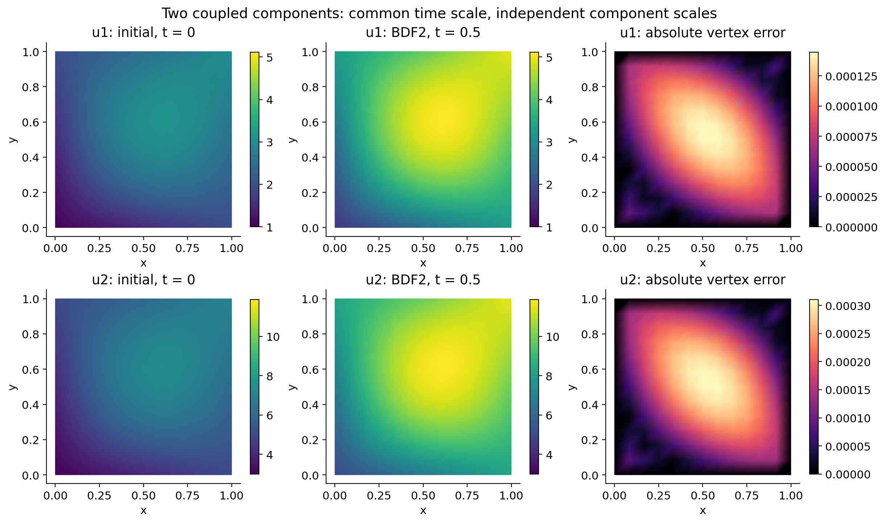
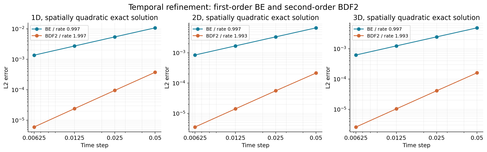
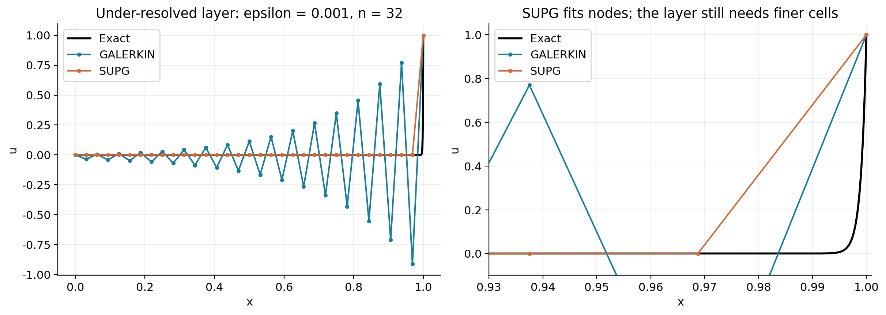

# FEALPy 多维向量含时 CDR 求解器

用有限元求解 **1、2、3 维、多个耦合分量、时变系数**的对流–扩散–反应方程。支持 **P1/P2、后向欧拉、二阶 BDF2、SUPG 强对流稳定化、VTU/PVD 时间序列**，附可复现数值验证、图片、任务报告和两份完整学习讲义。



## 方程

$$
d(\boldsymbol x,t)\partial_tu_i-\nabla\cdot(a(\boldsymbol x,t)\nabla u_i)
+\boldsymbol b(\boldsymbol x,t)\cdot\nabla u_i
+\sum_{j=1}^m C_{ij}(\boldsymbol x,t)u_j=f_i,\quad i=1,\ldots,m.
$$

空间维数 D 与未知量分量数 m 独立。a、d 为各分量共享的正标量，b 是公共空间速度，C 是反应耦合矩阵；非对角元允许分量间耦合。系数均可依赖空间和时间。时间项为 $d u_t$。边界采用全 Dirichlet 条件，含时问题另给初值。

## 快速运行

实测 Python 3.13.2、FEALPy 3.4.0、NumPy 2.3.4、SciPy 1.16.3、SymPy 1.14.0、Matplotlib 3.10.7、VTK 9.6.2。建议使用独立虚拟环境。

```bash
git clone https://github.com/menghuainanfang/FEALPy-project-cdr-solver.git
cd FEALPy-project-cdr-solver
python -m venv .venv
```

Windows PowerShell 激活：`.\.venv\Scripts\Activate.ps1`；Linux/macOS：`source .venv/bin/activate`。

```bash
python -m pip install -r requirements_extension.txt
python example_vector.py --dim 2 --n 12 --p 2 --steps 20
```

结果写入 `output/vector/`。在 ParaView 中打开 `solution.pvd`，点击 Apply，选择 `u_0` 或 `u_1`，播放时间序列。仓库已有 [21 帧结果](results_final/vtu/solution.pvd)，详见 [ParaView 指南](docs/向量含时结果_ParaView指南.md)。

## 定义自己的问题

```python
from fealpy.backend import backend_manager as bm
from cdr import CDRSolver, SymbolicCDR, box_mesh

bm.set_backend('numpy')
pde = SymbolicCDR(
    2, components=2,
    a='0.01*(1+t)', b=['1+t', '0.2'], d='1+t',
    reaction=[[2, -1], [-1, 2]],
    source=[1, 0], boundary=[0, 0], initial=[0, 0],
)
solver = CDRSolver(pde, box_mesh(pde, 12), p=1, stabilization='supg')
solver.solve_time(0.2, 20, scheme='bdf2', output='output/my_case')
print(solver.history[-1])
```

符号坐标为 `x,y,z,t`。也可继承 `CDRModel`，按 FEALPy 风格直接编写 `source(p,t)` 等方法，使用 `x=p[...,0]` 提取坐标；完整例子见 [cdr/cases.py](cdr/cases.py)。`exact=[...]` 可由制造解自动生成源项、边界和初值；未知精确解时直接输入实际数据。`solve_steady(t=...)` 求指定系数时刻的稳态问题。

## 数值证据

- 36 组空间加密实验覆盖 1—3 维、Galerkin/SUPG、P1/P2。平滑问题中 P1 趋近 $L^2$ 二阶、梯度误差一阶；P2 趋近三阶和二阶。
- 24 组时间加密实验用空间可精确表示的二次解分离时间误差。BDF2 最后一级观测阶约 **1.99—2.00**，后向欧拉约 **1.00**。
- 一至三维二次空间、一次时间的耦合解再现，检查完整 SUPG 残差；另用独立符号微分核对手工源项。
- 固定 f 删除反应非对角元，解发生变化；VTK 读回与 FE 顶点值一致。无精确解输入、四分量导出和接口隔离均有验证。




强对流边界层取 $\varepsilon=0.001$、速度沿 x 轴、精确值范围 $[0,1]$。节点上下界如下，未做数值截断：

| 维数 / 每方向分段 | Galerkin 最小值 | Galerkin 最大值 | SUPG 节点范围 |
| --- | --- | --- | --- |
| 1D / 32 | −0.9113 | 1.0000 | [0,1]，舍入误差内 |
| 2D / 32 | −1.2402 | 1.2646 | [0,1]，舍入误差内 |
| 3D / 8 | −7.1244 | 2.8119 | [0,1]，舍入误差内 |



SUPG 在这些算例中抑制了振荡。右图同时显示：粗网格上的线性函数还不能精确表示很薄的边界层。稳定性和解析精度需要分别判断。完整数值、参数和解释见 [任务报告](docs/向量含时CDR_任务报告.md)。

## 复现与兼容性

```bash
python verify_vector.py
python build_final_report.py
python illustrate_equation_properties.py
```

第一条计算并保存 CSV、JSON 和 VTU，第二条重绘图片并更新报告，第三条重绘数学讲义中的 Péclet 数与振荡机制图。三维 P2 使用稀疏直接法，完整验证比小示例耗时更长。

接口隔离脚本额外用 PyTorch 模拟其他调用者的后端选择；正常求解不需要它：

```bash
python -m pip install torch
python verify_vector_interfaces.py
```

测试通过 FEALPy 3.4.0 安装版及本机源码检出 `v3.4.1-47-ge033533bd-dirty`。未修改 FEALPy；导入不改变全局后端或 sys.path；导出不改调用者的网格节点数据。证据见 [安装版接口记录](results_final/interfaces_installed.json)和[源码版接口记录](results_final/interfaces_source.json)。

## 文件导航

| 位置 | 内容 |
| --- | --- |
| [cdr/](cdr/) | 当前向量求解器：数据、算例、SUPG、求解流程 |
| [example_vector.py](example_vector.py) | 命令行示例 |
| [verify_vector.py](verify_vector.py) | 数值正确性与收敛验证 |
| [verify_vector_interfaces.py](verify_vector_interfaces.py) | 依赖与接口隔离验证 |
| [results_final/](results_final/) | 原始数据、数值结果图与方程分析图、21 个 VTU 和 PVD |
| [任务报告](docs/向量含时CDR_任务报告.md) | 模型、实现、全部结果与限制 |
| [数学讲义](docs/CDR数学推导与学习讲义.md) | 适定性、唯一性、能量估计、强对流振荡机制及完整离散推导 |
| [代码讲义](docs/CDR代码与FEALPy源码学习讲义.md) | 完整核心代码拆解及 FEALPy 源码导读 |
| [ParaView 指南](docs/向量含时结果_ParaView指南.md) | 安装、播放、字段解释、保存图片 |

`results_extension/`、旧版标量程序及既有报告保留作为前一阶段资料。新项目入口和新结果分别位于 `cdr/`、`results_final/`，避免把旧标量接口与当前向量数据约定混用。

## 适用范围

当前为 NumPy/CPU、仿射线段/三角形/四面体、P1/P2、盒形全 Dirichlet 边界、线性系统、均匀时间步。尚未实现各向异性张量/交叉扩散、混合边界、曲面单元、非线性或自适应时间步。

SUPG 不保证任意网格和反应矩阵的单调性或正性，也没有非线性横风激波捕捉。P2 的 VTU 是顶点采样，不能完整保留高阶形状。大规模三维问题需要进一步研究迭代求解和预条件。项目是基于 FEALPy 的独立应用，不代表库内官方模型已合入这些扩展。
