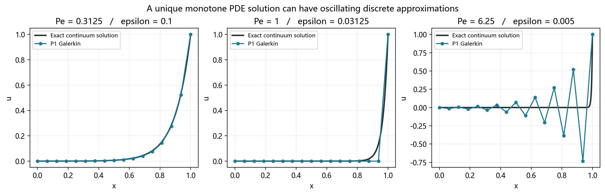

# 从微分方程到计算结果：向量含时 CDR 数学讲义

这份讲义面向学过微积分、线性代数，尚未系统学习有限元的数学本科生。我们的目标是把一个偏微分方程变成计算机能求解的线性方程组，并且知道结果为什么可信。建议先读第 1—3 节，理解方程、弱形式和适定性；再读第 7 节，用递推式理解强对流下的非物理振荡；随后读第 4—6、8—9 节，把有限元、时间离散、SUPG 与数值验证串起来。再结合[代码讲义](CDR代码与FEALPy源码学习讲义.md)运行程序。阅读完材料不等于掌握；文末的小题可用于自检。

## 1. 我们究竟在求什么

### 1.1 坐标、时间与未知量

空间维数记为 $D$，在程序中叫 `dim`；未知量的分量数记为 $m$，叫 `components`。两者是不同的概念。

- 一根细杆可以用一个坐标 $x$ 表示，$D=1$。如果同时研究两种物质的浓度，未知量有两个分量，$m=2$。
- 一个立方体需要 $(x,y,z)$ 三个坐标，$D=3$。若只研究温度，仍然可以只有一个未知量，$m=1$。

向量函数写成 $\boldsymbol u(\boldsymbol x,t)=(u_1,\ldots,u_m)^T$。这里的向量可以是一组物理量，并不一定是空间中的速度箭头。我们的方程是

$$
d\frac{\partial u_i}{\partial t}
-\nabla\cdot(a\nabla u_i)
+\boldsymbol b\cdot\nabla u_i
+\sum_{j=1}^m C_{ij}u_j=f_i,\qquad i=1,\ldots,m.
\tag{1}
$$

每个系数都可以依赖 $\boldsymbol x,t$。$a$ 和 $d$ 为各分量共享的正标量；$\boldsymbol b$ 有 $D$ 个空间分量；$C$ 是 $m\times m$ 的矩阵。$a$ 描述扩散，$\boldsymbol b$ 描述输运，$C$ 描述局部反应及分量交换，$f_i$ 是外部源项。

本项目采用全边界 Dirichlet 条件和初值：

$$u_i|_{\partial\Omega}=g_i(\boldsymbol x,t),\qquad u_i(\boldsymbol x,0)=u_{0,i}(\boldsymbol x).$$

Dirichlet 的含义只是“边界上直接给出未知量的值”。它不同于给出法向导数或流量。稳态问题删去 $d\partial_tu_i$，其余结构保留。

### 1.2 梯度和散度并不神秘

二维中

$$\nabla u=(u_x,u_y)^T,\qquad
\nabla\cdot(a\nabla u)=\partial_x(au_x)+\partial_y(au_y).$$

按乘法求导法则展开：

$$-\nabla\cdot(a\nabla u)=-a\Delta u-\nabla a\cdot\nabla u,\qquad
\Delta u=\sum_{k=1}^D u_{x_kx_k}.
\tag{2}$$

所以变系数扩散不能只写成 $-a\Delta u$。例如一维 $a=1+x^2,u=x^2$，有

$$-(au')'=-(2x+2x^3)'=-2-6x^2,$$

而 $-au''=-2-2x^2$，少了 $-4x^2$。程序的 `diffusion_gradient` 正是提供式 (2) 中的 $\nabla a$。

对流项是 $\boldsymbol b\cdot\nabla u$，不是 $\nabla\cdot(\boldsymbol b u)$。二者相差 $(\nabla\cdot\boldsymbol b)u$。本项目直接按前者实现。

### 1.3 时间前面的 d 是系数

式 (1) 中 $d$ 是容量系数；偏导符号是 $\partial$。即使 $d=d(t)$，我们仍采用 $d(t)u_t$。乘积求导则为

$$\partial_t(du)=d u_t+d_tu.$$

例如 $d=1+t,u=e^t$，则 $du_t=(1+t)e^t$，而 $\partial_t(du)=(2+t)e^t$。它们是两个不同模型。若物理题目指定后一种，必须保留多出的 $d_tu$，不能只改函数名。

### 1.4 一个真正耦合的例子

取

$$C=\begin{pmatrix}2&1\\1&5\end{pmatrix},\qquad
\boldsymbol u=\begin{pmatrix}1+x^2\\2+2x^2\end{pmatrix}.$$

第一行反应为 $2u_1+u_2=4+4x^2$，第二行为 $u_1+5u_2=11+11x^2$。若 $a=1,b=1$，稳态源项是

$$f_1=-2+2x+4+4x^2=2+2x+4x^2,$$
$$f_2=-4+4x+11+11x^2=7+4x+11x^2.$$

一个分量变化会影响另一个方程。如果把 $C$ 的非对角元去掉，同时保持这组 $f$ 和边界不变，解应当改变。这是验证代码确实实现“耦合”的好办法。

## 2. 为什么需要弱形式

### 2.1 从乘一个函数开始

先看一个分量。取一个在边界为零的光滑函数 $v$，方程两边乘 $v$ 后在区域上积分：

$$\int_\Omega d u_t v-\int_\Omega\nabla\cdot(a\nabla u)v
+\int_\Omega(\boldsymbol b\cdot\nabla u)v
+\int_\Omega\sum_j C_{ij}u_jv=\int_\Omega f_i v.$$

对扩散项分部积分：

$$-\int_\Omega\nabla\cdot(a\nabla u)v
=\int_\Omega a\nabla u\cdot\nabla v
-\int_{\partial\Omega}a\nabla u\cdot\boldsymbol n\,v.$$

边界上 $v=0$，最后一项消失。于是只要求 $u$ 和 $v$ 有一阶导数，而不再要求 $u$ 在每处都具有普通意义的二阶导数。这让连续、但单元之间导数可以跳变的分片多项式也能参与计算。

### 2.2 写成向量形式

$H^1(\Omega)$ 可以粗略理解为“函数和一阶弱导数的平方都能积分”的函数集合；$H_0^1$ 再要求边界值为零。令

$$V=[H_0^1(\Omega)]^m.$$

非零边界时，解在具有边界值 $\boldsymbol g$ 的仿射空间中，测试函数仍在 $V$ 中。对任意 $\boldsymbol v\in V$，要求

$$M_t(\partial_t\boldsymbol u,\boldsymbol v)+A_t(\boldsymbol u,\boldsymbol v)=F_t(\boldsymbol v),\tag{3}$$

其中

$$M_t(\boldsymbol w,\boldsymbol v)=\sum_i\int_\Omega d w_i v_i,$$
$$A_t(\boldsymbol w,\boldsymbol v)=\sum_i\left[\int_\Omega a\nabla w_i\cdot\nabla v_i
+\int_\Omega(\boldsymbol b\cdot\nabla w_i)v_i\right]
+\sum_{i,j}\int_\Omega C_{ij}w_jv_i,$$
$$F_t(\boldsymbol v)=\sum_i\int_\Omega f_i v_i.$$

下标 $t$ 提醒我们：系数变了，形式也随时间变化。测试分量 $i$ 决定矩阵行，未知分量 $j$ 决定矩阵列。

### 2.3 为什么不默认使用共轭梯度法

扩散项对 $u,v$ 对称，但对流项一般不对称，反应矩阵也可能不对称。因此最后的矩阵通常不是对称正定矩阵，不能仅因它来自有限元就使用需要对称正定条件的 CG。

本项目采用一般稀疏直接法；以后大规模问题可研究 GMRES 等非对称迭代方法及预条件，但那需要新的性能和稳定性验证。

## 3. 先研究方程：解是否存在、唯一、稳定

有限元方法的出发点是一个数学问题。应先问这个问题本身有什么性质，再问离散是否保留这些性质。本节对本项目的方程直接推导，先讨论零边界，再说明非零边界。所列条件以容易使用的**充分条件**为主，不把条件不满足误判为问题必然无解。

### 3.1 “适定”包含三件事

给定系数、源项、初值和边界，通常把以下三条合称为 Hadamard 意义的适定性：

1. **存在性**：指定的函数空间中至少有一个解。
2. **唯一性**：同样的数据不对应两个不同的解。
3. **连续依赖性**：数据改变一点，解在指定的范数下也只改变可控制的一点。

第三条必须说明范数。例如稳态零边界时，希望有

$$\|u-\widetilde u\|_{H_0^1}\le K\|f-\widetilde f\|_{H^{-1}}.$$

这里 $H^{-1}$ 是作用在 $H_0^1$ 上的连续线性泛函空间，其范数衡量源项对测试函数的作用大小。若 f 是普通平方可积函数，也可用更熟悉的 $L^2$ 范数给出估计。

适定性不等于解永远衰减，不等于每个分量非负，也不等于离散误差小。连续解唯一和矩阵可逆是不同层面的陈述。有限个求积点上的 a、d 为正，也不能代替整个区域上的正下界假设。

### 3.2 标量稳态：对流项为什么出现散度

固定一个时刻，先研究 $m=1$、$u|_{\partial\Omega}=0$。设区域有界且边界 Lipschitz，$a\in L^\infty$ 且 $a\ge a_0>0$，$b\in W^{1,\infty}$，$c\in L^\infty$。这表示系数有界、扩散有统一正下界，b 的一阶弱导数也有界。令 $V=H_0^1(\Omega)$，使用等价范数 $\|v\|_V=\|\nabla v\|_{L^2}$。

空间双线性形式为

$$A(u,v)=\int_\Omega a\nabla u\cdot\nabla v+\int_\Omega(b\cdot\nabla u)v+\int_\Omega cuv.$$

取 $v=u$。对流部分利用 $u\nabla u=\tfrac12\nabla(u^2)$：

$$\begin{aligned}
\int_\Omega(b\cdot\nabla u)u
&=\frac12\int_\Omega b\cdot\nabla(u^2)\\
&=\frac12\int_{\partial\Omega}(b\cdot n)u^2
-\frac12\int_\Omega(\nabla\cdot b)u^2\\
&=-\frac12\int_\Omega(\nabla\cdot b)u^2.
\end{aligned}$$

最后一步用到了零边界。因此

$$A(u,u)=\int_\Omega a|\nabla u|^2+\int_\Omega q u^2,
\qquad q=c-\frac12\nabla\cdot b.\tag{E1}$$

**控制能量的是有效反应 q，而不只是 c，也不只是速度大小。** 例如常速度 b 很大但散度为零时，对流不直接贡献这个零边界能量的正负项。它仍会影响解的形状和离散误差。

### 3.3 从一个不等式推出适定性

Poincaré 不等式说明，零边界函数满足

$$\|v\|_{L^2}\le C_P\|\nabla v\|_{L^2}.$$

可以直观理解为：边界被固定为零后，函数整体的幅度不能脱离它的空间变化而任意增大。对单位区间，最佳常数是 $1/\pi$；对单位 D 维盒，$C_P=1/(\pi\sqrt D)$。

若 $q\ge0$，由式 (E1) 直接得到

$$A(v,v)\ge a_0\|v\|_V^2.$$

更一般地，若 $q\ge-\gamma$，$\gamma\ge0$，则

$$A(v,v)\ge(a_0-\gamma C_P^2)\|v\|_V^2.$$

只要 $\alpha=a_0-\gamma C_P^2>0$，就有**强制性** $A(v,v)\ge\alpha\|v\|_V^2$。它意味着方程中的正扩散足以控制可能存在的负反应。

另一方面，用 Cauchy–Schwarz 和 Poincaré 得到

$$|A(u,v)|\le\big(\|a\|_\infty+C_P\|b\|_\infty+C_P^2\|c\|_\infty\big)\|u\|_V\|v\|_V.$$

这叫有界性。**Lax–Milgram 定理**告诉我们：有界且强制的双线性形式，对每个连续载荷 $F\in V'$，都给出唯一弱解。这里不要求 A 对称。标准定理及标量 CDR 应用可参阅 [Guermond 第 27 章 §27.1—27.2](https://people.tamu.edu/~guermond/M661_FALL_2017/chap27.pdf)。

本问题的稳定性常数也能直接算出。用解自身测试：

$$\alpha\|u\|_V^2\le A(u,u)=F(u)\le\|F\|_{V'}\|u\|_V,
\qquad \|u\|_V\le\alpha^{-1}\|F\|_{V'}.$$

如果两个解对应同样的系数但不同的载荷，两式相减，对差值用同一估计：

$$\|u-\widetilde u\|_V\le\alpha^{-1}\|F-\widetilde F\|_{V'}.$$

同样载荷时右端为零，差值只能为零，这证明唯一性；载荷接近时差值有界，这证明连续依赖。**存在性仍需要定理或构造证明，不能只凭“假设两个解然后相减”得出。**

若连系数也变化，记对应形式为 $\widetilde A$，可得到

$$\|u-\widetilde u\|_V\le\alpha^{-1}
\big(\|F-\widetilde F\|_{V'}+\|A-\widetilde A\|\,\|\widetilde u\|_V\big),$$

其中 $\|A-\widetilde A\|$ 是双线性形式的算子范数。数据扰动讨论需要保留统一的正下界；让 $a_0$ 趋近零会改变稳定性常数。

### 3.4 向量耦合：看 C 的对称部分

现在令 $V=[H_0^1(\Omega)]^m$。设 C 的每个元素有界，其他假设与上面相同。把 C 分为

$$C_s=\frac{C+C^T}{2},\qquad C_a=\frac{C-C^T}{2}.$$

对实向量 z，$z^TC_az=0$，因此能量只看到对称部分：

$$A(\boldsymbol v,\boldsymbol v)=\int_\Omega a\sum_i|\nabla v_i|^2
+\int_\Omega\boldsymbol v^TQ\boldsymbol v,
\qquad Q=C_s-\frac12(\nabla\cdot b)I_m.\tag{E2}$$

若 Q 的最小特征值在整个区域不小于 $-\gamma$，且 $a_0-\gamma C_P^2>0$，同样得到强制性、唯一弱解和连续依赖。若 $Q\succeq0$，条件尤其简单。

不能只检查 C 的对角元为正。例如

$$C=\begin{pmatrix}1&4\\4&1\end{pmatrix},\qquad
z=\begin{pmatrix}1\\-1\end{pmatrix},\qquad z^TCz=-6.$$

也不能对非对称 C 只看特征值的实部来代替上面的能量检验。反对称部分虽然在 $v^TCv$ 中消失，仍然会改变解的耦合运动与算子结构。

### 3.5 本项目的系数实际满足什么条件

`CoupledData` 使用

$$C=(1+t)\begin{pmatrix}2&-1/2\\-1/4&3\end{pmatrix},\qquad b_k=(1+t)(1+x_k).$$

于是

$$C_s=(1+t)\begin{pmatrix}2&-3/8\\-3/8&3\end{pmatrix},\quad
\nabla\cdot b=D(1+t).$$

对角和为5，对角差为−1，非对角为−3/8，所以括号内对称矩阵的两个特征值是

$$\frac{5\pm\sqrt{(2-3)^2+4(3/8)^2}}2
=\frac{5\pm5/4}{2}=\frac{15}{8},\frac{25}{8}.$$

因此

$$\lambda_{\min}(Q)=(1+t)\left(\frac{15}{8}-\frac D2\right).$$

| D | $\lambda_{\min}(Q)/(1+t)$ |
| --- | --- |
| 1 | 11/8 |
| 2 | 7/8 |
| 3 | 3/8 |

在已计算的 $t\in[0,0.5]$ 中它们都为正，且 $a=(1+t)(1+\sum x_k^2)\ge1$。所以当前平滑算例的**冻结时间稳态问题**确实满足上述强制性条件。这是方程层面的判断，与线性求解器有没有报错无关。

### 3.6 充分条件没通过，不代表无解；但负反应确实可能引起共振

看一个完全能手算的问题：

$$-u''-\lambda u=f,\qquad u(0)=u(1)=0.$$

当 $f=\sin(\pi x)$ 且 $\lambda\ne\pi^2$ 时，

$$u=\frac{\sin(\pi x)}{\pi^2-\lambda}$$

是一个解。如果 $\lambda$ 接近 $\pi^2$，源项的微小变化就会造成明显放大。对于固定的非特征值 $\lambda$，问题仍可适定，但稳定性常数很大。

在 $\lambda=\pi^2$ 时：

- 若 $f=0$，任意倍数的 $\sin(\pi x)$ 都是解，唯一性失效。
- 若 $f=\sin(\pi x)$，方程无解。把两边乘 $\sin(\pi x)$ 并分部积分，左边为0，右边为 $\int_0^1\sin^2(\pi x)dx=1/2$，矛盾。

完整的 Dirichlet 特征值为 $k^2\pi^2$。只要 $\lambda$ 不等于这些值，这个问题仍有唯一弱解；例如 $\lambda=2\pi^2$，上面的简单强制性条件没有通过，方程却并不奇异。这说明强制性条件是方便可靠的充分条件，不是所有适定问题的必要条件。谱观点可参阅 [Hunter 第 4 章](https://www.math.ucdavis.edu/~hunter/pdes/ch4.pdf)。

### 3.7 非零边界如何纳入证明

稳态时，假定边界值 g 是某个 $G\in[H^1(\Omega)]^m$ 的迹；在 Lipschitz 区域，通常取 $g\in[H^{1/2}(\partial\Omega)]^m$ 即可。写成 $u=w+G$，那么 w 的边界为零，方程变为

$$A(w,v)=F(v)-A(G,v).$$

右端仍是连续线性泛函，就回到了前面的证明。G 叫边界提升函数，它不是唯一的，但最终的 u 不依赖任意选择。

含时问题还多出 $-dG_t$。可要求 $G\in L^2(0,T;H^1)$，$G_t\in L^2(0,T;H^{-1})$，并具有适当的初始迹，使提升后的载荷和初值属于下节空间。要求经典光滑解时，还要满足 $u_0|_{\partial\Omega}=g(\cdot,0)$ 等相容条件。弱解的初值可以仅为 $L^2$，此时不应对它强行要求未定义的逐点边界迹。

### 3.8 含时问题：容量 d 变化时的能量恒等式

先取零边界，设 $0<d_0\le d(x,t)\le d_1$，d 的空间和时间一阶导数有界，其他系数满足统一椭圆性与有界性假设。定义

$$E(t)=\frac12\int_\Omega d(x,t)|\boldsymbol u(x,t)|^2.$$

对 t 求导时要同时对 d 求导：

$$\int_\Omega d\boldsymbol u_t\cdot\boldsymbol u
=E'(t)-\frac12\int_\Omega d_t|\boldsymbol u|^2.$$

用 u 测试方程，并应用式 (E2)，得到

$$E'(t)+\int_\Omega a|\nabla\boldsymbol u|^2
+\int_\Omega\boldsymbol u^TQ_t^{\rm eff}\boldsymbol u
=\langle f,\boldsymbol u\rangle,
\qquad Q_t^{\rm eff}=C_s-\frac12(\nabla\cdot b)I_m-\frac12d_tI_m.\tag{E3}$$

这里 $Q_t^{\rm eff}$ 的下标表示含时有效矩阵，不表示对 Q 再求时间导数。**原 PDE 是 $du_t$，式 (E3) 中出现 $d_t$ 是能量求导的结果，并没有把模型改成 $(du)_t$。**

若 $Q_t^{\rm eff}\succeq-\eta I_m$，其中 $\eta\ge0$ 是时空统一常数，则用 Young 不等式：

$$|\langle f,u\rangle|\le\|f\|_{V'}\|u\|_V
\le\frac{a_0}{2}\|u\|_V^2+\frac1{2a_0}\|f\|_{V'}^2.$$

又因为 $\|u\|_{L^2}^2\le2E/d_0$，所以

$$E'(t)+\frac{a_0}{2}\|u\|_V^2
\le\frac{2\eta}{d_0}E(t)+\frac1{2a_0}\|f(t)\|_{V'}^2.$$

记 $\kappa=2\eta/d_0$，乘 $e^{-\kappa t}$ 再积分，即得 Grönwall 型估计

$$E(t)\le e^{\kappa t}\left[E(0)+\frac1{2a_0}\int_0^te^{-\kappa s}\|f(s)\|_{V'}^2ds\right].\tag{E4}$$

对两个解的差重复此推导，同样数据时 $E(0)=0$、源项差为0，故差解恒为0；不同数据时得到连续依赖。这一结论允许能量随时间增长，只要求在任意固定有限 T 内有可控界。

在上述假设、$f\in L^2(0,T;V')$、$u_0\in[L^2]^m$ 下，可得到唯一弱解

$$u\in L^2(0,T;V)\cap C([0,T];[L^2]^m),\qquad u_t\in L^2(0,T;V').$$

存在性的构造思路是：先取有限维基，求质量矩阵正定的常微分方程组；使用与维数无关的式 (E4) 控制近似解；提取弱收敛子列并通过线性方程的极限；最后用唯一性识别极限。d 及 $1/d$ 的空间正则性保证相关乘法在弱空间中合法。一般抛物方程的 Galerkin 构造和能量方法见 [Hunter 第 6 章 §6.3—6.5](https://www.math.ucdavis.edu/~hunter/pdes/ch6.pdf)；式 (E3)—(E4) 是针对本项目变容量、有限分量系统的直接计算。

对当前算例 $d_t=1$。在三维 t=0 时，$Q_t^{\rm eff}$ 的最小特征值为 $3/8-1/2=-1/8$；这并不妨碍适定性。甚至由单位盒的 Poincaré 常数可得

$$\int a|\nabla v|^2+\int v^TQ_t^{\rm eff}v
\ge\left(1-\frac1{24\pi^2}\right)\|\nabla v\|^2>0.$$

这是对零边界未知量或同边界解之差的估计。制造解自身具有非零边界和非零源项，不能据此声称它的总能量单调下降。

### 3.9 唯一性、正性、最大值原理和光滑性要分别判断

**标量最大值原理。** 对足够光滑、均匀椭圆的标量方程，若 $c\ge0$ 且 $f\le0$，则有上界 $u\le\max(0,\sup_{\partial\Omega}g)$。直观地，在一个正的内部最大值处，梯度为零、Laplacian 非正，故 $-\nabla\cdot(a\nabla u)+b\cdot\nabla u+cu\ge0$，与严格负源项矛盾；非严格情形还需标准的扰动/弱最大值原理论证。不能仅凭这个点态观察完成全部弱解证明。特别是 $c=f=0$ 时，解在边界最小值和最大值之间。

这与 $c-\tfrac12\nabla\cdot b\ge0$ 的能量判据不是同一个条件。它们服务于不同性质，不应混为一个通用开关。

**向量正性。** 对当前共享扩散和对流的含时系统，保证非负数据保持分量非负的一组常用充分条件是 $C_{ij}\le0$（$i\ne j$）、系数有界且满足前述抛物性、初值/边界/源项分量非负。在某分量将从0穿向负值时，其余分量通过 $-C_{ij}u_j$ 提供非负贡献。这类系统称为合作系统。证明可用各分量负部作测试及能量估计。它不能保证每个分量都不超过各自初值最大值。

仅有能量正定不保证分量非负。例如纯反应 $u_t+Cu=0$，取 $C=\begin{pmatrix}2&1\\1&2\end{pmatrix}$、$u(0)=(1,0)^T$，C 的特征值为1和3，解唯一且能量衰减，但 $u_2'(0)=-1$，第二分量立刻变负。此时负值是该方程的真实结果，不能都归咎于数值振荡。

**正则性。** 弱解存在只保证相应的 Sobolev 空间性质，不自动保证处处可二阶求导。更光滑的系数、区域和相容数据才能支持更高阶正则性。薄层解对每个固定正扩散可以很光滑，但高阶导数随扩散趋零而迅速增大，这正是后面网格分辨率问题的根源。

### 3.10 方程与离散之间有哪些结论不能直接跨越

在相同强制性假设、符合型子空间和精确积分下，普通 Galerkin 稳态矩阵可逆：若齐次离散解为 $u_h$，取测试函数 $u_h$ 即有 $\alpha\|u_h\|_V^2\le0$。但矩阵可逆不保证其逆逐项非负，因此仍可产生过冲和欠冲。

SUPG 改变了测试形式，BDF2 又加入历史系数；它们分别需要离散稳定性分析。前面连续方程的证明不能自动作为“任意网格上的 SUPG 保正”或“任意步长 BDF2 保正”的证明。本项目的数值实验验证指定算例，不替代这些不同层次的定理。

## 4. 网格与有限元：用有限个数表示函数

### 4.1 一维 P1 的帽子函数

把 $[0,1]$ 划成小区间。每个节点对应一个函数 $\phi_j$：它在本节点等于 1，其他节点等于 0，在相邻单元内是直线。近似解写成

$$u_h(x,t)=\sum_{j=0}^{N}U_j(t)\phi_j(x).$$

因此 $U_j$ 正是节点值。二维三角形 P1 在每个三角形上是一次多项式；三维四面体类似。P2 则使用二次多项式，除顶点外还有边中点自由度。

| 单元 | P1 局部自由度数 | P2 局部自由度数 |
| --- | --- | --- |
| 线段 | 2 | 3 |
| 三角形 | 3 | 6 |
| 四面体 | 4 | 10 |

局部自由度属于一个单元；全局自由度把相邻单元共享的节点合并。连续有限元就是通过共享自由度实现跨单元连续。

### 4.2 单元上的三个小矩阵

在 $[x_L,x_R]$ 上令 $h=x_R-x_L$，两个 P1 基函数是

$$\phi_1=(x_R-x)/h,\quad\phi_2=(x-x_L)/h,\quad
\phi_1'=-1/h,\quad\phi_2'=1/h.$$

常系数时，按“行是测试函数 $i$，列是试探函数 $j$”定义矩阵：

$$K_{ij}=\int a\phi'_j\phi'_i
\quad\Longrightarrow\quad K=\frac a h\begin{pmatrix}1&-1\\-1&1\end{pmatrix},$$
$$B_{ij}=\int b\phi'_j\phi_i
\quad\Longrightarrow\quad B=\frac b2\begin{pmatrix}-1&1\\-1&1\end{pmatrix},$$
$$M_{ij}=\int\phi_j\phi_i
\quad\Longrightarrow\quad M=\frac h6\begin{pmatrix}2&1\\1&2\end{pmatrix}.$$

注意 $B$ 的两行相同，不是对称矩阵。反应 $c$ 为常数时贡献 $cM$，容量 $d$ 贡献 $dM$。源项 $f=1$ 时局部右端为 $(h/2,h/2)^T$。

### 4.3 两个单元的纸笔算例

求 $-u''=2$，$u(0)=u(1)=0$，网格节点为 $0,1/2,1$。每个单元 $h=1/2$，局部扩散矩阵为

$$\begin{pmatrix}2&-2\\-2&2\end{pmatrix}.$$

把共享中点上的贡献相加：

$$A=\begin{pmatrix}2&-2&0\\-2&4&-2\\0&-2&2\end{pmatrix},\qquad
F=\begin{pmatrix}1/2\\1\\1/2\end{pmatrix}.$$

边界 $U_0=U_2=0$，中间一行变为 $4U_1=1$，故 $U_1=1/4$。精确解 $u=x(1-x)$ 在中点也等于 $1/4$，但有限元解是两段直线，并不是整条抛物线。这个例子已经说明“节点正确”与“整个函数精确”之间的区别。

### 4.4 向量块矩阵

若标量空间有 $N_s$ 个自由度，两个分量按

$$U=(U_{1,1},\ldots,U_{1,N_s},U_{2,1},\ldots,U_{2,N_s})^T$$

排列。空间矩阵是

$$A=\begin{pmatrix}K+B+R_{11}&R_{12}\\R_{21}&K+B+R_{22}\end{pmatrix},\qquad
(R_{ij})_{kl}=\int C_{ij}\phi_l\phi_k.$$

反应系数即使随空间变化，也不改变块结构。容量共享且不直接混合分量，所以普通质量矩阵为 $\operatorname{diag}(M_d,M_d)$。

## 5. 数值积分和边界条件

### 5.1 为什么计算机还要做求积

一般系数的积分没有方便的原函数。对一个单元 $K$，使用求积点 $\boldsymbol x_q$ 和归一化权重 $w_q$：

$$\int_K g(\boldsymbol x)\,d\boldsymbol x\approx |K|\sum_qw_qg(\boldsymbol x_q).$$

在本项目使用的 FEALPy 网格规则中，权重与单元度量分开使用。系数、基函数、梯度都在这些点求值，再进行乘加。`q` 是积分规则的阶数参数，不应把它简单看成每个单元恰好有 q 个点。

默认组装使用 `q=p+4`，误差积分再提高两级。平滑算例中这足够支持已报告的收敛观察；厚度远小于网格的指数层可能仍需更细网格或更高阶积分。

### 5.2 非零边界必须影响右端

把自由度分成内部 I 和边界 B：

$$\begin{pmatrix}A_{II}&A_{IB}\\A_{BI}&A_{BB}\end{pmatrix}
\begin{pmatrix}U_I\\g_B\end{pmatrix}=\begin{pmatrix}F_I\\F_B\end{pmatrix}.$$

内部方程是

$$A_{II}U_I=F_I-A_{IB}g_B.\tag{4}$$

所以不能只把边界行替换为单位行而随意丢弃边界列的影响。`DirichletBC` 先扣除 $Ag$，再处理边界行列与右端。本项目每个新时间层都执行这个过程，使用该时刻的 $g$。

时间迭代历史向量包含过去时刻的边界值。这是正常的：历史项和当前边界值在差分式中承担不同角色。

## 6. 从常微分方程组到时间格式

空间离散以后，式 (3) 变为

$$M(t)\dot U(t)+A(t)U(t)=F(t).\tag{5}$$

这里是 $M\dot U$，不是 $\frac d{dt}(MU)$。后者还会出现 $\dot M U$。

### 6.1 后向欧拉

取均匀时间点 $t_n=n\Delta t$。以

$$\dot U(t_{n+1})\approx\frac{U^{n+1}-U^n}{\Delta t}$$

替换导数，所有系数在 $t_{n+1}$ 计算，得

$$\left(M^{n+1}+\Delta t A^{n+1}\right)U^{n+1}
=M^{n+1}U^n+\Delta t F^{n+1}.\tag{6}$$

泰勒展开给出导数近似误差为 $O(\Delta t)$，在足够正则和稳定的条件下全局时间误差通常也是一阶。

### 6.2 BDF2 的系数从哪里来

在 $t_{n+1}$ 展开：

$$U^n=U^{n+1}-\Delta t\dot U+\tfrac12\Delta t^2\ddot U-\tfrac16\Delta t^3U^{(3)}+\cdots,$$
$$U^{n-1}=U^{n+1}-2\Delta t\dot U+2\Delta t^2\ddot U-\tfrac43\Delta t^3U^{(3)}+\cdots.$$

取 $3U^{n+1}-4U^n+U^{n-1}$，常数项和二阶导数项恰好消掉，得到

$$\frac{3U^{n+1}-4U^n+U^{n-1}}{2\Delta t}
=\dot U(t_{n+1})-\frac13\Delta t^2U^{(3)}(t_{n+1})+O(\Delta t^3).$$

代入式 (5)：

$$\left(\tfrac32M^{n+1}+\Delta t A^{n+1}\right)U^{n+1}
=M^{n+1}\left(2U^n-\tfrac12U^{n-1}\right)+\Delta t F^{n+1}.\tag{7}$$

质量矩阵始终取新时刻。把右侧改为 $2M^nU^n-\tfrac12M^{n-1}U^{n-1}$ 会改变对时间项的离散，不再是式 (1) 的直接 BDF2。

### 6.3 第一步怎么办

最开始只有 $U^0$，没有 $U^{-1}$。本项目用后向欧拉计算 $U^1$，之后进入 BDF2。在光滑问题上，一次 BE 起步得到的第一步解误差为 $O(\Delta t^2)$，满足二阶多步方法的起步精度需要。不能把“全程使用 BE 的一阶误差”混同于“只用一次 BE 起步”。

### 6.4 稳定不是所有值都不增长

对测试方程 $y'=-\lambda y$，$\lambda>0$，BE 的放大因子为 $1/(1+\lambda\Delta t)$，幅度不超过 1。BDF2 也是 A 稳定方法；该结论针对线性测试方程的稳定域，不能直接推出任意耦合离散系统都保持正性。

如果反应系数使物理模型本来就增长，正确解也应该增长。例如 $u_t-u=0$ 的解是 $e^t$。数值算法不应把真实增长“稳定”成常数。BDF2 的方法背景可参阅 [SUNDIALS 数学说明](https://sundials.readthedocs.io/en/v6.0.0/cvode/Mathematics_link.html)。

## 7. 强对流为什么会让普通方法振荡

### 7.1 一个可以看见的边界层

考虑

$$-\varepsilon u''+b u'=0,\qquad u(0)=0,u(1)=1,\quad b=1.$$

令 $w=u'$，有 $w'=w/\varepsilon$，于是 $w=K e^{x/\varepsilon}$。再积分并使用边界条件：

$$u(x)=\frac{e^{(x-1)/\varepsilon}-e^{-1/\varepsilon}}{1-e^{-1/\varepsilon}}.\tag{8}$$

当 $\varepsilon$ 很小时，几乎全区间都接近 0，只有出口 $x=1$ 附近快速上升。变化宽度约为 $\varepsilon$。计算式 (8) 时使用指数不大于零的形式，可以避免直接计算 $e^{1/\varepsilon}$ 溢出。

### 7.2 单元 Péclet 数

定义

$$Pe=\frac{|b|h}{2\varepsilon}.$$

它比较“一个单元尺度上的对流作用”与“扩散作用”。一维均匀 P1 Galerkin 的内部行中，左右邻点系数分别是

$$-\varepsilon/h-b/2,\qquad-\varepsilon/h+b/2.$$

当 $Pe>1$，后一个系数变为正数，产生非物理振荡的风险。$\varepsilon=0.001,h=1/32$ 时 $Pe=15.625$，已经很大。整个问题有解并不代表粗网格离散会给出合理的曲线。

### 7.3 原方程的边界层是单调的，并没有自行振荡

对式 (8) 求导，有

$$u'(x)=\frac{e^{(x-1)/\varepsilon}}{\varepsilon(1-e^{-1/\varepsilon})}>0.$$

所以任何固定 $\varepsilon>0$ 时，精确解都从0单调增加到1，且唯一。对常速度 b=1、c=0，有 $\nabla\cdot b=0$，稳态能量是 $\varepsilon\|u'\|^2$，也满足第3节的强制性条件。**同一个问题可以在连续层面适定，在粗网格离散层面却出现非物理振荡。**

边界层厚度的估计也能定量解释。距离出口 $k\varepsilon$ 时，主要指数项约为 $e^{-k}$；k=1 时约0.368，k=3 时约0.050。只用一个宽度 $h\gg\varepsilon$ 的单元跨过它，就没有足够的局部自由度描出这段陡变。

### 7.4 从有限元矩阵推到振荡递推式

仍取一维均匀 P1、常系数、无源无反应，并按单元精确积分。把相邻两个单元的扩散和对流矩阵加到内部节点 i，得到

$$\left(-\frac\varepsilon h-\frac b2\right)U_{i-1}
+\frac{2\varepsilon}{h}U_i
+\left(-\frac\varepsilon h+\frac b2\right)U_{i+1}=0.\tag{O1}$$

除以 h，这正是熟悉的中心差分形式：

$$-\varepsilon\frac{U_{i+1}-2U_i+U_{i-1}}{h^2}
+b\frac{U_{i+1}-U_{i-1}}{2h}=0.$$

设 $b>0$，定义相邻增量 $\delta_i=U_i-U_{i-1}$，整理可得

$$\left(\varepsilon-\frac{bh}{2}\right)\delta_{i+1}
=\left(\varepsilon+\frac{bh}{2}\right)\delta_i.$$

当 $Pe=bh/(2\varepsilon)\ne1$ 时，

$$\delta_{i+1}=r\delta_i,\qquad r=\frac{1+Pe}{1-Pe}.\tag{O2}$$

- $0<Pe<1$ 时，r 为正，增量同号；在这个常系数边界层问题中，边界给定的正总增量对应单调节点值。
- $Pe>1$ 时，r 为负，连续两个增量必然反号。解在相邻节点间一增一减，形成锯齿。
- $Pe=1$ 时不能除以零。直接回到增量方程，得内部所涉及的 $\delta_i=0$；在0、1边界下，所有内部点为0，最后一个单元连到出口1。此时不振荡，但层仍然被很粗地表示。

精确指数解在相邻网格上的增量之比是 $e^{bh/\varepsilon}=e^{2Pe}>0$。因此 $Pe>1$ 时离散 r 的负号没有对应的物理指数模式，它是中心离散产生的。

项目的一维强对流算例为 $h=1/32$、$\varepsilon=0.001$、b=1，故

$$Pe=15.625,\qquad r=\frac{16.625}{-14.625}=-\frac{133}{117}\approx-1.13675.$$

相邻增量反号且幅度向出口增加，这正好解释图中出口附近越来越明显的锯齿。它不是矩阵求解精度不足：把这个离散系统解到机器精度，仍会得到同样的离散振荡。中心 Galerkin 与对流占优问题的背景可参阅 [Praveen Chandrashekar 的有限元课程讲义](https://math.tifrbng.res.in/~praveen/notes/cm2013/fem_hyp.pdf)；式 (O1)—(O2) 是这里从本项目单元矩阵直接得到的推导。

### 7.5 为什么“非对角元变正”值得关注

将式 (O1) 改写为

$$U_i=\left(\frac12+\frac{Pe}{2}\right)U_{i-1}
+\left(\frac12-\frac{Pe}{2}\right)U_{i+1}.$$

两个权重的和为1。当 $Pe\le1$ 时它们非负，内部值是相邻值的加权平均；当 $Pe>1$ 时，一个权重为负，内部值可以超出两侧值的范围。普通的平均直觉已经失效。

对这个带 Dirichlet 边界的一维系统，非正非对角元、适当的对角占优及边界连接结构能使内部矩阵成为非奇异 M 矩阵，其逆逐项非负，从而支持离散比较原理。不是所有“非对角元非正”的矩阵都自动有这个性质，更不能把一维 Pe 阈值不加条件地照搬到任意二维/三维网格。

在多维中，网格角度、流向、扩散结构、反应项和边界均影响离散比较原理。P2 基函数也没有与 P1 完全相同的正性结构。本项目的多维实验报告实际节点范围，不把它升级成所有网格的保正定理。

### 7.6 一张图分开“无振荡”与“准确解析”

三幅图都在 $[0,1]$ 上取16个单元、b=1、边界0和1，只改变扩散。黑线是连续精确解，蓝线连接 P1 Galerkin 节点。左图 $Pe<1$，中图 $Pe=1$，右图 $Pe>1$。中图虽然没有负值，但折线仍不等于指数层；右图则还出现额外锯齿。绘图数据直接由式 (O1) 装配，脚本为 `illustrate_equation_properties.py`，不依赖求解器中的 SUPG 实现。

### 7.7 强对流也是一个奇异极限问题

对 $-\varepsilon u''+bu'=0$，当 $\varepsilon>0$ 时是二阶方程，通常需要两个端点条件；形式上令 $\varepsilon=0$ 后，只剩一阶输运方程 $bu'=0$。

若 b>0，信息从左向右传播，输运极限自然指定入口 $u(0)=0$，给出内部解 u=0；它无法同时满足出口 $u(1)=1$。小而正的扩散就通过出口附近的薄层来满足第二个条件。因此这不是把一个小项删掉后所有性质都连续不变的普通扰动。

多维相应的入口边界由 $b\cdot n<0$ 定义；纯输运问题的边界条件需要按特征方向重新分析。现有代码要求正扩散并使用全 Dirichlet，不能把 a 直接设为0就声称已经实现一般纯输运求解器。

### 7.8 有收敛定理，为什么粗网格仍可能很差

对固定正扩散，精确积分的符合型 Galerkin 在强制性条件下满足 Céa 估计

$$\|u-u_h\|_V\le\frac{M}{\alpha}\inf_{v_h}\|u-v_h\|_V,$$

非齐次边界时需对合适提升和逼近空间作相应处理。这个不等式说离散误差受到最佳逼近误差控制，不说控制常数总是很小。对扩散为 $\varepsilon$ 的问题，$\alpha$ 常随 $\varepsilon$ 变小，而 M 含有对流系数，因此 $M/\alpha$ 可能很大。

另一方面，式 (8) 的第 k 阶导数规模约为 $\varepsilon^{-k}e^{(x-1)/\varepsilon}$，其 $L^2$ 范数约为 $\varepsilon^{1/2-k}$。有限元插值误差中的高阶导数常数会随薄层变陡而增大。**固定扩散时 h 趋零的收敛，不等于对所有小扩散都有统一精度。**

当 $h\ll\varepsilon/|b|$ 时，网格才能充分解析流线方向的层；若大部分区域很平滑而仅出口有层，局部加密通常比全局均匀加密经济。本项目使用均匀网格，尚未实现这种自适应策略。

### 7.9 SUPG 修复的是哪一部分

下一节的 SUPG 在常系数一维 P1 例子中增加沿流向扩散，使有效 Péclet 数变为

$$Pe_{\rm eff}=\frac{|b|h}{2(\varepsilon+\tau b^2)}=\tanh(Pe)<1.$$

这恢复了该特殊离散系统的合适符号结构，并能拟合指数解的节点。然而单元内部仍是直线；提高稳定性不等于凭空创造细网格分辨率。

这一机制解释了为什么本项目同时做两类实验：粗网格强对流看振荡与节点上下界，平滑解和逐步解析的层看误差与收敛。两种证据回答的问题不同。

## 8. SUPG：沿流线加入完整方程残差

### 8.1 加什么，为什么这样加

单元 $K$ 上，第 i 个方程的强残差定义为

$$R_i(\boldsymbol u_h)=d\partial_tu_{h,i}-a\Delta u_{h,i}
-\nabla a\cdot\nabla u_{h,i}+\boldsymbol b\cdot\nabla u_{h,i}
+\sum_j C_{ij}u_{h,j}-f_i.$$

在普通弱形式上增加

$$\sum_K\sum_i\int_K\tau_K(\boldsymbol b\cdot\nabla v_{h,i})R_i(\boldsymbol u_h)=0.\tag{9}$$

测试函数被沿流向调整，所以称为流线上风 Petrov–Galerkin。若代入光滑精确解，每个 $R_i=0$，新增项就消失，这叫一致性。若只添加对流部分、却漏掉非零源项或反应项，精确解一般不再满足修改后的方程。

P1 在单元内部 $\Delta u_h=0$，但变系数时 $\nabla a\cdot\nabla u_h$ 仍然存在。P2 的 Hessian 一般不为零，所以必须计算其迹来得到 Laplacian。这里用的是每个单元内部的强残差，不是把跨单元梯度跳跃当成普通二阶函数值。

### 8.2 稳定参数的两个极限

本项目采用流线参数

$$\tau=\frac{h_b}{2|\boldsymbol b|}\left(\coth Pe-\frac1{Pe}\right),\qquad
Pe=\frac{|\boldsymbol b|h_b}{2a}.$$

仿射单纯形上，令 $\lambda_i$ 为重心坐标，取

$$h_b=\frac{2|\boldsymbol b|}{p\sum_i|\boldsymbol b\cdot\nabla\lambda_i|}.$$

对一维 P1，$h_b$ 就是单元长度 h。P2 使用除以 p 的尺度选择；多维应用是流线尺度的推广，不具有一维节点拟合公式的普遍精确性。变系数时参数在求积点计算。

当 $Pe$ 很小时，直接相减会损失有效数字，使用

$$\coth Pe-1/Pe=Pe/3-Pe^3/45+O(Pe^5),$$

所以 $\tau\approx h_b^2/(12a)$。当 $Pe$ 很大时，$\tau\approx h_b/(2|\boldsymbol b|)$。速度为零时稳定化测试方向也为零，代码直接取 $\tau=0$。

### 8.3 一维为什么能拟合节点

一维常系数、无源无反应、稳态 P1 情形，新增项为

$$\int_K\tau b^2u_h'v_h',$$

相当于把扩散从 $\varepsilon$ 改成

$$\varepsilon_{\rm eff}=\varepsilon+\tau b^2
=\frac{|b|h}{2}\coth Pe.$$

离散齐次方程的相邻差值之比为

$$\frac{\varepsilon_{\rm eff}/h+b/2}{\varepsilon_{\rm eff}/h-b/2}
=e^{bh/\varepsilon}\quad(b>0),$$

与精确指数解在相邻节点间的比例一致。因此该特殊问题中节点可以精确拟合。但基函数仍是分段直线，单元内形状并没有变成指数函数。

### 8.4 SUPG 如何进入代码中的 M、A、F

定义单元测试权 $T_i=\tau\boldsymbol b\cdot\nabla\phi_i$。对标量空间的行 i、列 j，质量修正为

$$S^M_{ij}=\int_K T_i d\phi_j.$$

向量分量 r、s 对应的空间修正为

$$S^{A,rs}_{ij}=\int_K T_i\left[C_{rs}\phi_j+
\delta_{rs}(\boldsymbol b\cdot\nabla\phi_j-a\Delta\phi_j-\nabla a\cdot\nabla\phi_j)\right].$$

右端修正为

$$S^{F,r}_i=\int_K T_i f_r.$$

组装后得到 $\widehat M=M+S^M,\widehat A=A+S^A,\widehat F=F+S^F$，再代入 BE 或 BDF2。因此含时 SUPG 并不是只给空间矩阵加一个黏性项。

方法的原始来源是 [Brooks 与 Hughes 的 SUPG 论文](https://www.sciencedirect.com/science/article/pii/0045782582900718)。

## 9. 怎样证明计算结果值得相信

### 9.1 代数残差只回答一个问题

求得 U 后计算

$$r=\frac{\|AU-F\|_2}{\max(1,\|F\|_2)}.$$

很小的 r 说明线性方程组求解准确。但如果装配时扩散符号写反，错误的方程组也能有很小的残差。因此还需要边界检查、独立源项推导和精确解比较。

### 9.2 制造解：先选答案，再造题目

真实问题通常不知道解。验证代码时却可以先选择一个光滑 $\boldsymbol u$，代入强形式计算 $\boldsymbol f$，同时取相应边界和初值。此时精确答案已知。

本项目令 $w=1+\sum x_k+\prod\sin(\pi x_k)$，取 $\boldsymbol u=(w,2w+1)^T$ 验证空间阶。时间验证换成 $w=1+\sum x_k^2$ 和 $\boldsymbol u=e^t(w,2w+1)^T$。

后一个 w 能被 P2 精确表示，因此缩小时间步时不会很快被空间逼近误差掩盖。如果同时任意改变网格与时间步，就很难判断误差下降到底来自哪一个方向。

另取 $\boldsymbol u=(1+t)(w,2w+1)^T$，空间二次、时间一次，作为接近舍入误差水平的再现测试。手工源项再与独立符号微分交叉核对，避免只依靠同一段实现自我证明。

### 9.3 两种误差范数

向量 $L^2$ 误差为

$$E_0=\left[\int_\Omega\sum_i(u_i-u_{h,i})^2\right]^{1/2}.$$

梯度误差半范数为

$$E_1=\left[\int_\Omega\sum_i\sum_k(\partial_{x_k}u_i-\partial_{x_k}u_{h,i})^2\right]^{1/2}.$$

程序结果中的 `H1` 指 $E_1$。完整 $H^1$ 误差还应合并 $E_0$，成为 $\sqrt{E_0^2+E_1^2}$。

一个数是不是“小”，要结合解的幅度、单位、关注的物理量和网格成本。$10^{-3}$ 对幅度为 1 的浓度与对幅度为 $10^{-6}$ 的浓度有完全不同的意义。图上两条线重合也不等于误差为零。

### 9.4 收敛阶怎么计算

假设 $E(h)\approx Ch^r$，把 h 减半：

$$\frac{E(h)}{E(h/2)}\approx2^r,\qquad
r\approx\log_2\frac{E(h)}{E(h/2)}.$$

例如误差从 0.008 降到 0.002，则阶数约为 2；从 0.008 降到 0.001，阶数约为 3。时间阶同理，用 $\Delta t$ 替代 h。

在解足够光滑、网格规则、问题满足适当稳定性及对偶正则性的条件下，Pp 的常见预期是 $E_1=O(h^p)$、$E_0=O(h^{p+1})$。理论有前提；尖角、薄层、欠积分和粗网格都可能让观测阶数暂时偏离。

所有实测数值可在[任务报告](向量含时CDR_任务报告.md)及 CSV 中逐项查到。三维 P1 的最细层仍只有每方向 8 段，所以报告保留其接近但未完全达到理论值的实际阶数。

## 10. 看图与 ParaView 时怎样理解数据

VTU 存放一个时刻的非结构网格和节点场；PVD 把多个 VTU 及其真实时间列成序列。画面中的颜色通常是某个分量或模长，不是误差。只有把数值解与精确解作差，才得到误差图。

本项目导出顶点采样。P2 的边中点自由度参与求解，但普通顶点输出不完整保留二次形函数。因此 ParaView 显示适合观察演化和场分布，精确积分误差仍以求解器的有限元函数计算为准。

## 11. 适用范围与后续问题

本讲义对应线性、共享正标量 a 和 d、共享速度 b、反应矩阵 C 耦合、1—3 维盒形区域、全 Dirichlet 边界、P1/P2 和均匀时间步的实现。它不直接覆盖各向异性张量扩散、交叉扩散、非线性反应或其他边界类型。

SUPG 沿流向控制振荡，不提供任意网格上的最大值原理，也不能保证任意反应矩阵的解非负。未解析的横风内层还可能需要自适应网格、横风稳定或通量限制方法。代码不把解截断到某个范围，因此误差与节点上下界可以真实反映算法行为。

## 12. 八个纸笔自检题

1. 一维 $a=1+x,u=x^2,b=2,c=3$，计算稳态 f。答案：$f=-2+3x^2$；中间步骤为 $-(au')'=-2-4x$，再加 $4x+3x^2$。
2. 若两个网格误差为 $1.6\times10^{-3}$ 和 $2.0\times10^{-4}$，h 减半，阶数是多少？答案：3。
3. 二分量、标量空间 5 个自由度，第一分量第 3 个节点在向量中的零起始索引为 2，第二分量同一节点为 7。请写出所有 10 个位置的排列。
4. $a$ 变而 P1 的单元内二阶导数为零，SUPG 的扩散残差是否全为零？答案：不一定，还剩 $-\nabla a\cdot\nabla u_h$。

5. 对 $-u''-\lambda u=f$、零端点边界，为什么 $\lambda=\pi^2$ 可能不唯一，也可能无解？答案：f=0 时有任意倍数的第一特征函数；f 为第一特征函数时违反正交相容条件。
6. b 是一个很大的常向量，$\nabla\cdot b$ 是多少？它是否直接破坏式 (E1) 的强制性？答案：散度为0，不直接破坏；但会增大单元 Pe，影响离散单调性与误差常数。
7. 当 Pe=2 时，式 (O2) 的增量比是多少？答案：−3，因此相邻增量反号；不能把这样的锯齿解释成式 (8) 的真实单调边界层。
8. 若 d=1+t，为什么能量恒等式有 $-\tfrac12\int|u|^2$，却不能在原 PDE 中自行添加 $d_tu$？答案：前者来自对加权能量求导的恒等变换，后者会改变方程模型。

能独立完成这些题后，可在代码中找到对应位置：`source`、收敛阶计算、`TensorFunctionSpace` 和 `supg_terms`。下一步最有价值的练习是自己选一个二次向量制造解，手算 f，再运行 P2 再现验证。
