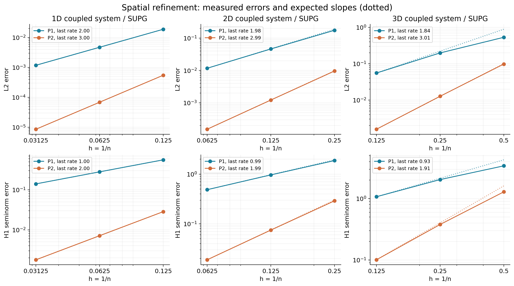

# FEALPy CDR 求解器

[科研工作库](../../README.md) · [学习练手项目](../README.md)

用有限元求解对流—扩散—反应方程，从一维稳态逐步扩展到 **1—3 维、多物质耦合、含时与强对流稳定化**。本仓库同时提供可运行程序、零基础培训讲义和汇报网页。

[在线汇报](https://menghuainanfang.github.io/FEALPy-project-cdr-solver/学习练手项目/cdr-solver/05_%E6%B1%87%E6%8A%A5/index.html) · [任务与成果报告](05_汇报/任务工作与产出成果.md) · [数学讲义](02_学习讲义/01_数学原理讲义.md) · [程序讲义](02_学习讲义/02_程序入门讲义.md) · [开发阶段档案](06_开发阶段/README.md)


## 项目解决什么问题

对第 r 个物质求解：

$$
d(\boldsymbol{x},t)\partial_tu_r
-\nabla\cdot(a(\boldsymbol{x},t)\nabla u_r)
+\boldsymbol b(\boldsymbol{x},t)\cdot\nabla u_r
+\sum_{s=1}^{m}C_{rs}(\boldsymbol{x},t)u_s=f_r.
$$

扩散描述浓度的空间均匀化，对流描述输运，反应矩阵描述各物质的相互作用，容量控制时间变化。空间维数与物质数相互独立。模型给出系数、源项、边界和初值；求解器返回有限元系数及随时间变化的场。

当前支持一次/二次拉格朗日有限元（P1/P2）、后向欧拉法（BE）、二阶后向差分公式（BDF2）、流线迎风彼得罗夫—伽辽金法（SUPG）、VTU/PVD 时序输出。

## 三个入口

**汇报展示**：打开上方在线汇报，或下载整个仓库后双击「打开汇报网页.cmd」。也可直接打开 05_汇报/index.html。离线网页不需要 Python、服务器或网络。

**运行程序**：进入 01_程序，按照下面的命令安装，先运行三个节点的手算对照，再运行双分量演示。

**系统学习**：从 [学习顺序](04_学习路线/01_学习顺序.md) 开始。数学与程序两份主讲义分别建立概念和实现主线；[FEALPy 拆解](03_FEALPy学习/00_库与项目的边界.md) 单独解释原生库；[联合逐行阅读路线](04_学习路线/03_FEALPy与求解器逐行阅读.md) 连接两边的源码。

## 目录

| 路径 | 职责 |
|---|---|
| 01_程序/ | 当前维护的 cdr 包、示例、验证与安装配置 |
| 02_学习讲义/ | 数学原理、程序入门两份主讲义 |
| 03_FEALPy学习/ | FEALPy 的网格、空间、积分器、装配、边界与求解 |
| 04_学习路线/ | 难度递进、练习、学习断点与后续源码路线 |
| 05_汇报/ | 离线网站、详细任务报告、结果图与验证数据 |
| 06_开发阶段/ | 按开发能力划分的历史入口与完整版本下载 |

历史代码通过固定提交保存，当前目录只维护一套求解器。阶段编号表示开发能力层次，不代表 Python 包版本或对旧接口的兼容承诺。

## 快速运行

推荐 Python 3.13；当前依赖要求 Python ≥3.11。首次安装需要联网。Windows：

```powershell
git clone https://github.com/menghuainanfang/FEALPy-project-cdr-solver.git
cd FEALPy-project-cdr-solver/学习练手项目/cdr-solver/01_程序
python -m venv .venv
.venv\Scripts\python -m pip install -e .
.venv\Scripts\python example_minimal.py
.venv\Scripts\python example_vector.py --dim 2 --n 4 --p 1 --steps 4 --output output/demo
```

macOS/Linux 使用 python3 创建环境，将后续解释器替换成 .venv/bin/python。也可在 Windows 双击 setup.cmd，再运行 run.cmd。完整说明与每个程序的分类见 [程序 README](01_程序/README.md)。

最小例子求解 −u''=2、u(0)=u(1)=0，打印节点 [0,0.5,1] 与值 [0,0.25,0]。双分量例子的 output/demo/solution.pvd 可用 ParaView 播放。

## 项目代码与 FEALPy 的边界

```python
from fealpy.backend import backend_manager as bm  # FEALPy 原生接口
from cdr import CDRSolver, SymbolicCDR, box_mesh   # 本项目接口

bm.set_backend("numpy")
pde = SymbolicCDR(
    dim=2, components=2,
    a="0.01*(1+t)", b=["1+t", "0.2"], d="1+t",
    reaction=[[2, -1], [-1, 2]],
    source=[1, 0], boundary=[0, 0], initial=[0, 0],
)
solver = CDRSolver(pde, box_mesh(pde, n=12), p=1)
uh = solver.solve_time(0.2, 20, output="output/my_case")
```

该例没有提供精确解。SymbolicCDR 是项目的符号数据模型，也可以继承项目 CDRModel 用普通数组方法提供数据。

FEALPy 提供网格、LagrangeFESpace、TensorFunctionSpace、标准积分器、BlockForm、DirichletBC 和 spsolve；项目提供 CDR 数据约定、分量耦合组织、时间推进与 SUPG 局部残差。Python 解释器负责执行代码，不等同于上述求解器。安装本项目不会把这些项目接口添加到 FEALPy 原生命名空间，也不代表已被官方收录。

## 数值证据

2026-10-10 在 Windows、Python 3.13.2、FEALPy 3.4.0 下通过完整验证：

- 36 组空间收敛：覆盖 1—3 维、P1/P2、Galerkin/SUPG。
- 24 组时间收敛：后向欧拉约一阶，BDF2 最后一级观测阶约 1.99—2.00。
- 6 组多项式一致性、6 组强对流对比、3 组边界层加密。
- 非对角反应耦合、源项独立核对、VTU 读回与接口隔离。
- 安装版与本地 FEALPy 源码接口测试，以及项目外目录安装调用。



原始 CSV、JSON 和 21 帧时序结果位于 [成果数据](05_汇报/成果数据)。具体网格、误差、条件与解释见 [任务报告](05_汇报/任务工作与产出成果.md)。残差小不等于 PDE 离散误差小，SUPG 抑制振荡也不等于边界层已被充分解析。

在 01_程序 目录复现：

```text
python check_environment.py
python verify_vector.py --output output/verification
python -m pip install torch
python verify_vector_interfaces.py output/interfaces.json
```

以上 python 指安装了本项目的虚拟环境解释器。torch 只用于接口验证中的后端隔离检查，实际求解不依赖它。

## 开发阶段与后续学习

[00 问题调研](06_开发阶段/00_问题调研/README.md) → [01 一维稳态](06_开发阶段/01_一维稳态/README.md) → [02 多维标量含时](06_开发阶段/02_多维标量含时/README.md) → [03 多分量与稳定化](06_开发阶段/03_多分量与稳定化/README.md) → 当前可安装程序与培训交付。

学习路线从三节点手算开始，再解释数组形状与自由度排列；随后结合 FEALPy 源码阅读装配、边界、时间推进，最后阅读 SUPG。后续逐行教学将以当前程序为主，历史版本用于比较能力如何扩展，不混用不同阶段的接口。

## 适用范围

当前为 NumPy/CPU、仿射线段/三角形/四面体、P1/P2、轴对齐盒区域、全 Dirichlet 边界、正标量扩散与容量、共享输运系数和线性反应耦合、固定时间步。尚不支持各向异性或交叉扩散、混合边界、非线性反应、GPU 或自适应时间步。

SUPG 不保证任意问题的非负性。P2 的 VTU 输出为顶点采样，不保存全部二次自由度。macOS/Linux 尚无本项目的实机验证；安装步骤与本机测试环境分别标注。
