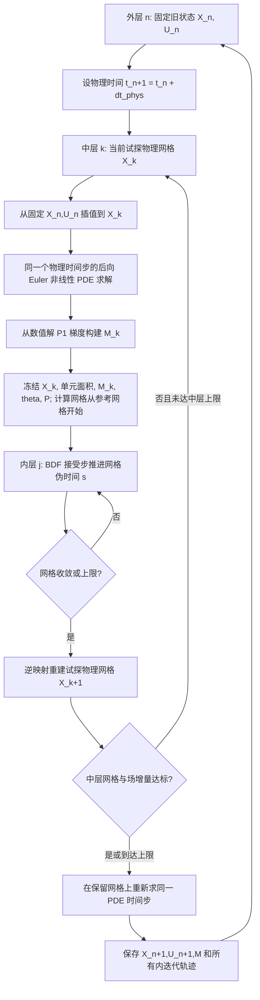
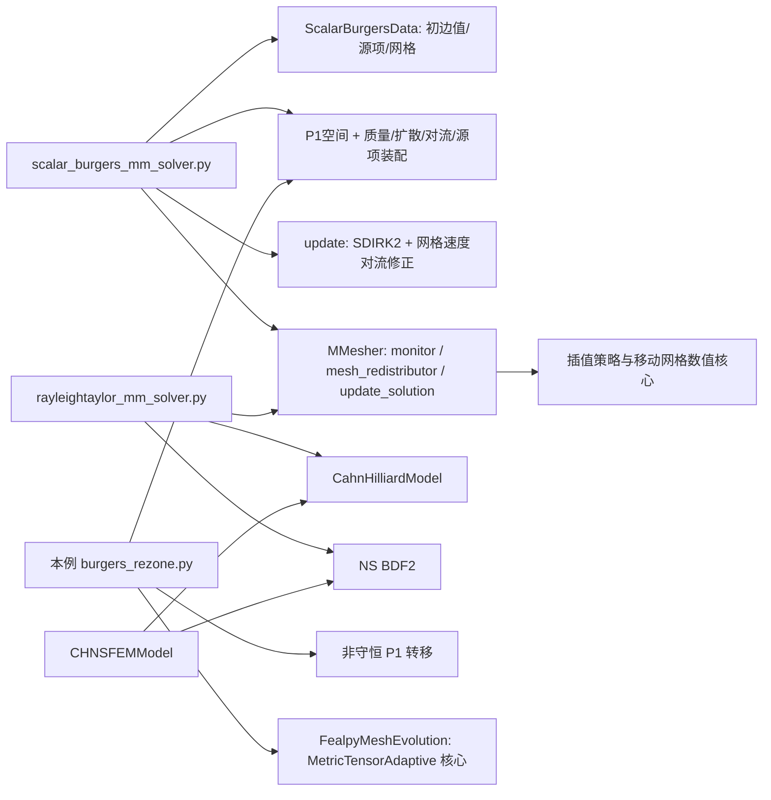

# 物理时间、PDE–网格交替与网格伪时间

## 三层算法（本机已验证）

默认二维 n=8，初始内部扰动 ±0.2/n，种子42，ν=0.05，Δt_phys=0.02，推进3个物理步。中层上限6，网格内层上限 s=3。
`src/burgers_rezone.py:run` 保存 t_n 的网格 X_n 与有限元场 U_n；新时间步从该网格继续。

物理 PDE 为

\[
u_t+u(u_x+u_y)-\nu\Delta u=f,\quad (x,y)\in(0,1)^2,
\qquad u_*(x,y,t)=e^{-t}\sin(\pi(x-0.4t))\sin(\pi y).
\]

初值、Dirichlet边界和源项由 u_* 给定；内部自由度由 PDE 求解。源项为
f=−u_*−0.4∂_x u_*+u_*(∂_x u_*+∂_y u_*)+2νπ²u_*。
空间使用本机 FEALPy P1 Galerkin、质量/扩散/对流/源项积分器；时间采用后向Euler；Picard迭代至自由分量非线性残量
||A(U)U−b||/max(||b_free||,1) ≤ 1e−9，最多30次。边界强制精确赋值。代码：`BurgersData.fields`、`solve_step`。

中层构造的数值度量为 M_K=I+2 g_K g_Kᵀ/(1+|g_K|²)，g_K=∇U_h|K。度量从本次 PDE 数值解计算，`metric_version` 每个中层递增；在一次网格求解中冻结。
中层一致性要求 max_i|X_i^(k+1)−X_i^k|/(1/n) ≤ 1e−3，且将上一中层解插值到当前网格后，相对场差 ≤ 1e−4，同时网格内层已经 converged。
`outer_converged` 表示这组增量判据。每个中层解决同一个 t_n→t_n+1 步，不把 k 次交替当作 k 个物理步。

重分区使用旧物理网格上的分片线性插值，每次都从固定的 (X_n,U_n) 转移，避免重复转移旧时间层造成累积平滑。
算法属于“重分区后在固定网格上求一步”的分裂法；网格伪时间速度不作为物理 ALE 速度。`transfer` 对常量与仿射场精确。
常量场的转移和后向Euler PDE 更新均在测试中保持至1e−12以内；单位方形边界和三角形正定向另作检查。

静态输入 `--static` 只做一次冻结网格优化，physical_time=0，PDE状态为 `not_advanced_static_input`，不生成虚构的PDE误差。

## 本机 FEALPy 依赖图与接口（源码可见）

源代码根目录本机核验为 `C:/Users/10251/fealpy`，SHA见诊断文件。

|能力|源码位置/函数|本轮状态与复用|
|---|---|---|
|Burgers物理时间、网格速度、场更新|`example/meshopt/mmesh/scalar_burgers_mm_solver.py:Burgers_MMsolver.update/solve`（130、443行）|源码可见；SDIRK2、网格速度对流修正、`mm.update_solution`；本例复用FE装配体系，使用独立后向Euler重分区路径|
|上游网格初始化|`fealpy/mmesh/pde/scalar_burgers_data.py:ScalarBurgersData.set_mesh`（44、60行）|本机已验证：新schema Mesh缺少meshdata，初始化在写vertices时失败；上游完整时间推进待验证|
|上游移动网格配置与插值|`scalar_burgers_mm_solver.py:moving_mesher`（92行）|源码可见：linear转移、monitor、BDF_SMW；该高层路径未在本轮跑通|
|Rayleigh–Taylor、CH与NS|`example/meshopt/mmesh/rayleightaylor_mm_solver.py`（153–190行）|源码可见：CH/NS更新均接收move_vector；本轮未运行|
|CH–NS封装|`fealpy/cfd/chan_hilliard_navier_stokes_fem_model.py:CHNSFEMModel.run`（97行）|源码可见；本轮未运行|
|Allen–Cahn|`example/fem/allencahn_lfem_example.py`（43行time_step参数）|源码可见：另一物理时间基线入口；本轮未运行|
|本例PDE与转移|`src/burgers_rezone.py:solve_step/transfer/run`（64、40、125行）|本机已验证；不修改第三方源码|
|内层数值核心|`src/fealpy_mesh_evolution.py:FealpyMeshEvolution/solve`（20、181行）|本机已验证：库内能量、解析导数、装配、平衡和投影；本地逐BDF步诊断|

上游接口探测记录：`results/mentor_2026-10-23/upstream_probe.json`，重跑 `python -m tools.probe_fealpy_burgers`。探测结果明确区分“模块可导入”与“实例初始化/物理步已运行”。

## 导师论文公式与本例的关系（原文与源码可见）

本地原文为 `论文精读/papers/2601.20235v2.pdf`，24页，封面日期2026-09-17。
本轮提取核对第3–15页正文，并渲染目视核对第4、9、13页；这些页的PDF页码与印刷页码一致。

|对象|原文位置|本例对应|
|---|---|---|
|逆拉回张量|第4页式(5)、(8)、(9)|论文 J_phys=E Ê⁻¹，P=J_phys⁻¹=Ê E⁻¹，A=P M⁻¹Pᵀ；演示中的 `J=ÊE⁻¹` 指这里的P，方向必须区分|
|迹—对数系数|第4页 κ_θ=p d^(p−1)θ^p=d^p(γ/2)θ^p|FEALPy `I_func` 同一系数结构，额外除以冻结全局 λ=d^pθ^p(1−p logθ)；当前度量M≥I时λ为正|
|平衡与ξ流|第9页式(16)–(18)|库内v=−P_diag ∇ξI/τ并施加边界投影。库内balance使用θ⁻¹，原文式(16)中相应因子是θ⁻¹/²；差异是每个冻结epoch的全局正缩放，当前实验保留库内定义|
|冻结与组装|第11–12页式(26)、(29)–(32)|本例复用库内 `Idxi_from_Ehat/vector_construction`；已有方向差分测试验证所用离散能量导数|
|BDF阶段解法|第13–14页式(33)–(39)、Algorithm 1|论文为Direct-Secant、可行残量下降与阶段残量容差；本例为SciPy BDF有限差分Jacobian，另加网格平衡停止，算法和“容差”含义不同|
|度量与参数|第14–15页式(40)–(43)|本例使用数值P1梯度生成的有界各向异性度量、γ=2、τ=0.1；不与论文Hessian/弧长度量及默认γ、τ混列|

## 限制与待验证事项

- 本例采用非守恒P1重分区，实际转移质量差单列；没有质量守恒结论。移动网格误差高于同初值固定网格，本例没有显示精度收益。
- 收敛是所声明的网格残量/增量和中层一致性判据；BDF阶段求解精度、中层增量、物理时间离散误差是不同对象。
- 论文第8页半离散物理坐标流的非退化结论不直接覆盖本例ξ流重建、SciPy全离散BDF或物理PDE耦合；正定向、能量下降与常量保持均只称本例验证。
- 本例验证二维、固定拓扑、单位方形与制造解；三维、论文原始Burgers基准、CH–NS/RT和Direct-Secant复现待验证。
